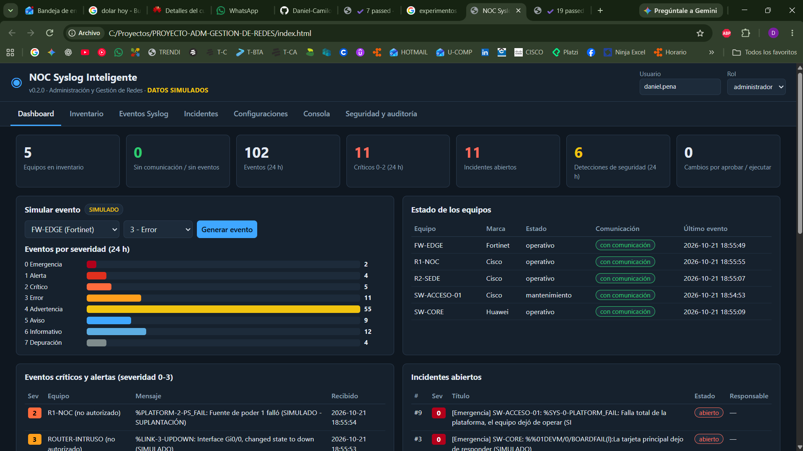

# NOC Syslog Inteligente

Aplicación web tipo **NOC** (centro de operaciones de red) que recibe, clasifica y muestra eventos **Syslog** de equipos **Cisco, Fortinet y Huawei**, gestiona incidentes y aplica una política de defensa frente a acciones de **agentes de inteligencia artificial**.

Hecha **solo con HTML, CSS y JavaScript**: no requiere instalar nada.

| | |
|---|---|
| **Versión** | v0.2.0 — Producto Mínimo Viable (Corte 2) |
| **Autor** | Daniel Camilo Peña Pulido |
| **Asignatura** | Administración y Gestión de Redes · Periodo 2026-2 |
| **Docente** | Ing. John Harold Pérez Calderón |
| **Ver en línea** | https://daniel-camilo-p.github.io/PROYECTO-ADM-GESTION-DE-REDES/ |
| **Datos** | ⚠️ Todos los equipos y eventos son **SIMULADOS** (IPs de documentación RFC 5737) |
| **Uso** | Académico |



## Problema que resuelve
Los mensajes de los equipos de red quedan dispersos y nadie los ve a tiempo. Esta herramienta los centraliza, los ordena por gravedad (0 a 7), abre incidentes cuando algo es crítico y deja registro de quién hizo qué. Además, impide que un log manipulado o un agente de IA ejecute cambios sin aprobación humana.

## Funciones
1. **Inventario editable** de equipos (nombre, IP, marca, modelo, versión, ubicación, estado, fecha de actualización).
2. **Receptor Syslog en vivo** (simulado, valida la IP de origen) e **importación** de archivos `.log`/`.txt`.
3. **Clasificación** por equipo, fabricante, fecha, facility y severidad 0-7 (formatos RFC 3164, RFC 5424, Cisco, Fortinet y Huawei).
4. **Dashboard** con estado de equipos, eventos recientes, eventos críticos e incidentes.
5. **Filtros** por fecha, marca, equipo, severidad y texto.
6. **Incidentes**: creación, asignación, seguimiento y cierre con causa y solución.
7. **Generador de configuraciones** Syslog comentadas para Cisco, Fortinet y Huawei.
8. **Consola tipo PuTTY simulada** de solo lectura con comandos permitidos y bloqueados.
9. **Política de defensa ante IA**: aprobación humana, listas permitidas, detección de inyección, validación de origen, control de tormentas, auditoría con hash y respaldo.

## Cómo usarla
**Opción 1 — En línea:** abra el enlace de GitHub Pages de la tabla de arriba.

**Opción 2 — En su computador:** descargue el repositorio (botón verde *Code → Download ZIP*), descomprímalo y haga **doble clic en `index.html`**. Funciona en Chrome, Edge y Firefox.

**Primeros pasos dentro de la aplicación:**
1. Pestaña **Eventos Syslog** → **Importar ejemplo (SIMULADO)** o **Iniciar recepción**.
2. Revise el **Dashboard**, filtre eventos y cree incidentes.
3. Use **Configuraciones**, **Consola** y **Seguridad y auditoría**.

## Pruebas
Abra **`pruebas.html`**: ejecuta 44 pruebas automáticas (inventario, syslog, incidentes, configuraciones, consola y seguridad) y debe mostrar **44 passed**. Plan completo en [docs/pruebas.md](docs/pruebas.md).

## Arquitectura
`Receptor / archivo / simulador → Motor de ingreso (validación + política) → API interna con roles → Datos del navegador → Interfaz`

La interfaz pide todo a una **API interna** (`NOC.api(...)`) que revisa roles, valida datos y audita. Diagramas en [docs/arquitectura.md](docs/arquitectura.md) y modelo de datos en [docs/modelo_datos.md](docs/modelo_datos.md).

## Configuración
Los valores de la política están en `js/nucleo/config.js`:

| Variable | Valor | Para qué sirve |
|---|---|---|
| `INCIDENTE_HASTA_SEVERIDAD` | 2 | Severidades 0-2 crean incidente |
| `ALERTA_HASTA_SEVERIDAD` | 3 | Severidades 0-3 se muestran como alerta |
| `LIMITE_POR_MINUTO` | 120 | Máximo de mensajes por origen por minuto |
| `VENTANA_DEDUP_SEGUNDOS` | 60 | Ventana para agrupar mensajes repetidos |
| `MINUTOS_SIN_COMUNICACION` | 30 | Minutos sin eventos para "sin comunicación" |
| `MAX_EVENTOS` | 5000 | Retención máxima de eventos |

## Seguridad
- La aplicación **no guarda contraseñas ni tokens**. Las que aparezcan dentro de un log se enmascaran (`***`).
- Los logs se tratan como **datos no confiables**: se muestran como texto y nunca se ejecutan.
- Toda acción de cambio sigue el flujo: *evento → validación → propuesta → revisión humana → aprobación → ejecución autorizada → verificación → auditoría*.
- Política completa: [docs/politica_defensa_ia.md](docs/politica_defensa_ia.md).

## Limitaciones de esta versión
- Un navegador no puede abrir el puerto UDP 514: la recepción en vivo es **simulada** y los logs reales se cargan por **importación** de archivos.
- Los datos se guardan en el navegador (localStorage) de cada computador. Use **Descargar respaldo** para conservarlos.
- Sin conexión SSH real (la ejecución es simulada) ni alertas por Telegram: requieren un backend (Corte 3).
- Roles simulados desde la interfaz, sin inicio de sesión con contraseña.

## Estructura
```
noc-syslog-inteligente/
├── index.html            # Aplicación
├── pruebas.html          # Pruebas automáticas
├── css/estilos.css       # Diseño
├── js/
│   ├── nucleo/           # Lógica: datos, API interna, seguridad, syslog, incidentes...
│   ├── vistas/           # Pantallas de cada pestaña
│   └── ui.js             # Utilidades de interfaz
├── data/                 # Syslog de ejemplo (SIMULADO)
├── tests/                # Pruebas
└── docs/                 # Alcance, requisitos, historias, diagramas, política, pruebas, evidencias
```

## Documentación
[Alcance](docs/alcance.md) · [Requisitos](docs/requisitos.md) · [Historias de usuario](docs/historias.md) · [Arquitectura](docs/arquitectura.md) · [Modelo de datos](docs/modelo_datos.md) · [Política de defensa ante IA](docs/politica_defensa_ia.md) · [Pruebas](docs/pruebas.md)

## Referencias
RFC 5424 (Syslog), RFC 5425 (TLS), RFC 5426 (UDP), RFC 5737 (IPs de documentación), Cisco IOS XE System Logging, Fortinet FortiOS `log syslogd setting`, Huawei `info-center loghost`, NIST AI RMF, OWASP Agentic AI.

---
Proyecto académico individual · Uso educativo · 2026
