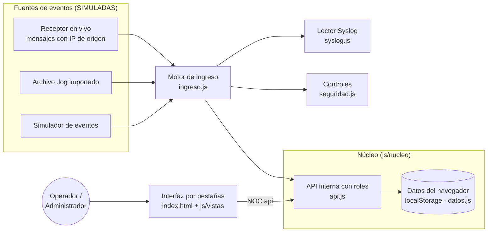
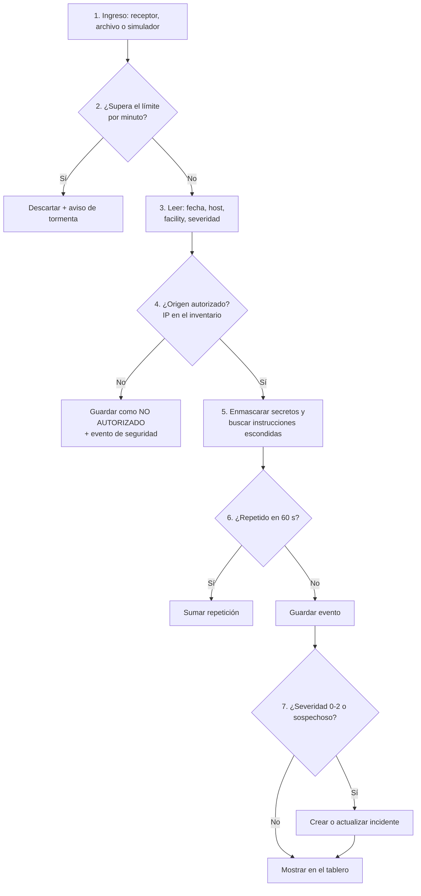
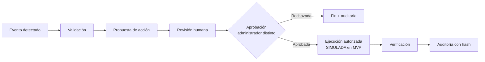

# Arquitectura y diagramas — NOC Syslog Inteligente v0.2.0

> GitHub dibuja automáticamente los diagramas de este archivo (formato Mermaid).

La aplicación está hecha **solo con HTML, CSS y JavaScript**. Corre completa en el navegador: no necesita servidor ni instalación. Se abre con doble clic en `index.html` o desde GitHub Pages.

## 1. Arquitectura general

**Idea clave:** la interfaz nunca toca los datos directamente. Todo pasa por la **API interna** (`NOC.api("POST", "/api/devices", ...)`), que revisa el rol, valida los datos y registra la auditoría. En el Corte 3 esa API se puede mover a un servidor real sin cambiar la interfaz.

## 2. Flujo de un evento (política)

## 3. Flujo seguro de cambios (obligatorio)

## 4. Módulos
| Archivo | Fase | Responsabilidad |
|---|---|---|
| `index.html` | 1 | Estructura de la página y pestañas |
| `css/estilos.css` | 1 | Diseño visual |
| `js/nucleo/config.js` | 1 | Valores de la política (severidades, límites, SLA) |
| `js/nucleo/datos.js` | 1 | Almacén de datos, equipos simulados, respaldo |
| `js/nucleo/api.js` | 1 | API interna: rutas, roles y errores |
| `js/ui.js` | 1 | Utilidades de interfaz y navegación |
| `js/nucleo/seguridad.js` | 2 | Validación, inyección, secretos, rate limit, SHA-256, auditoría |
| `js/nucleo/inventario.js` + `js/vistas/inventario.js` | 2 | Inventario (CRUD) |
| `pruebas.html` + `tests/` | 2-6 | Pruebas automáticas en el navegador |
| `js/nucleo/syslog.js` | 3 | Lee mensajes Syslog de 5 formatos |
| `js/nucleo/ingreso.js` | 3 | Política de ingreso de eventos |
| `js/nucleo/eventos.js` + `js/vistas/eventos.js` | 3 | Receptor, importación, filtros |
| `js/nucleo/incidentes.js` + `js/vistas/incidentes.js`, `dashboard.js` | 4 | Incidentes y tablero |
| `js/nucleo/configuraciones.js` + vista | 5 | Plantillas Cisco / Fortinet / Huawei |
| `js/nucleo/consola.js` + vista | 5 | Consola simulada |
| `js/nucleo/acciones.js` + `js/vistas/seguridad.js` | 6 | Aprobación humana, auditoría, respaldo |
