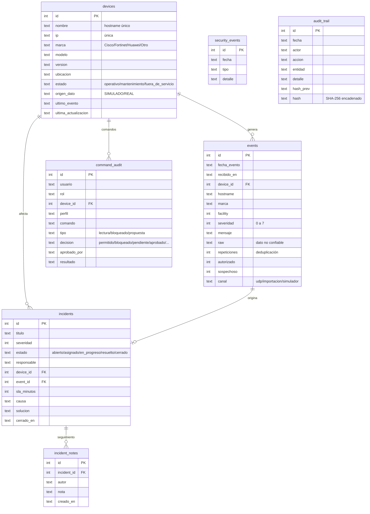

# Modelo de datos — NOC Syslog Inteligente v0.2.0

Los datos se guardan en el **navegador** (localStorage) como un objeto JSON con 7 "tablas" (listas). Se crean solas al abrir la aplicación. El detalle está comentado en `js/nucleo/datos.js`. Se pueden exportar e importar como respaldo `.json`.

